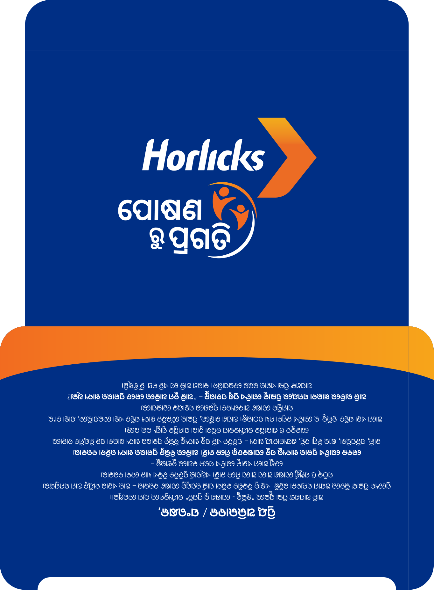
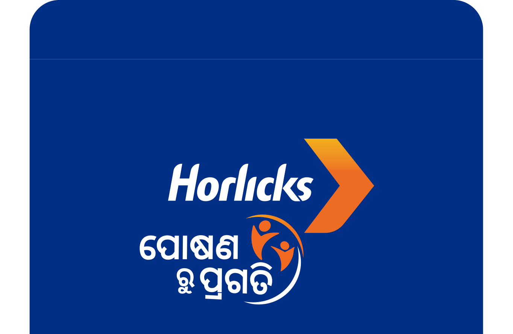
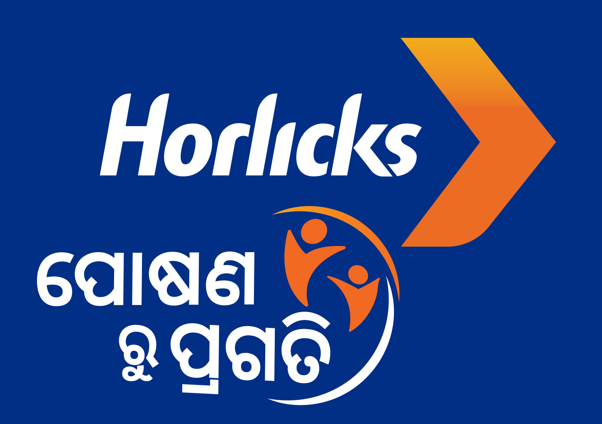
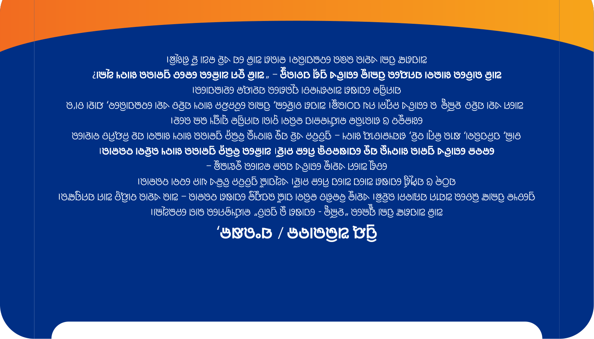
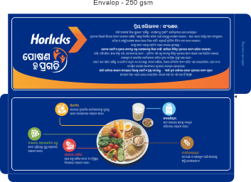
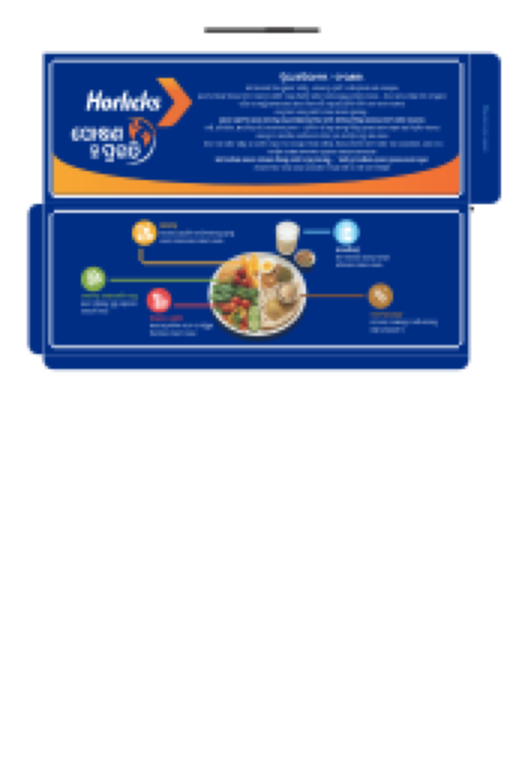
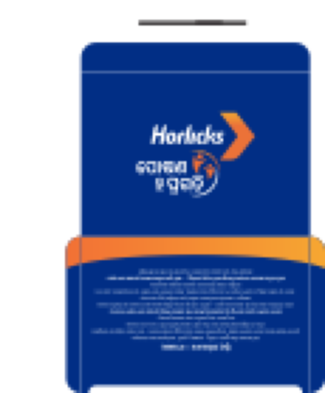
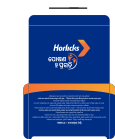
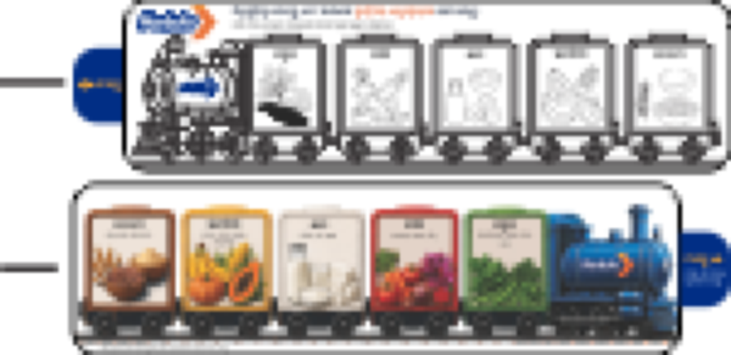
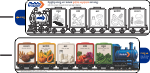

# Client creatives: what the client sent (17 Nov 2026)

Source files are in [`raw-assets/`](../raw-assets). All snapshots below are in [`client-creatives/`](client-creatives) (open them in any image viewer; no Photoshop/CorelDRAW needed).

> **Status:** for review. Nothing in the app has been changed based on these yet. See [Questions to confirm](#questions-to-confirm).

---

## Summary

| # | File | Type | What it is |
|---|---|---|---|
| 1 | `Horlicks Oriya envelope High Res.pdf` | PDF, 1 page, 721 KB | Print artwork of **one side of an envelope** (front, with fold flaps) |
| 2 | `Horlicks Oriya.cdr.zip` | **CorelDRAW source file**, 9.6 MB | Not a normal zip: CorelDRAW X4+ saves its files as a zip internally. **3 pages:** Envelope (outside + inside), a small envelope front, and a **Train** activity chart |

Both were made in **CorelDRAW 2026** on 16 Nov 2026 (author "WIN 11", last edited by "Lakshat"). The language is **Odia**, set up for **print** (CMYK, 300 dpi).

**Campaign name found in the artwork:** **ପୋଷଣ ରୁ ପ୍ରଗତି**, *"Poshan ru Pragati"* ≈ **"From Nutrition to Progress"**.

---

## 1. Envelope PDF: `Horlicks Oriya envelope High Res.pdf`

| Property | Value |
|---|---|
| Pages | 1 |
| Size | 491 × 666 pt ≈ **173 × 235 mm** (includes the fold flaps) |
| Content | 100 % vector (744 shapes). **All text converted to outlines**, no embedded fonts, no photos |
| Created by | CorelDRAW 2026 (Corel PDF Engine 27.2), 16 Nov 2026 18:52 IST |
| Quality | Sharp at any size; the logo can be extracted cleanly from it |

### Full envelope

### Top half: logo panel
- Navy background with the **new flat white "Horlicks" wordmark** and an **orange gradient chevron**.
- Below it, the Odia programme logo **ପୋଷଣ ରୁ ପ୍ରଗତି** with two orange child figures inside a white/orange arc.

### Logo lockup (cropped from the PDF, 400 dpi)

### Bottom half: Odia message
- Curved **orange → amber band**, then ~14 lines of white Odia text and a closing signature line.

> ⚠️ **Please have an Odia reader check this text before printing.** To a non-Odia reader the body text here does **not** look like normal Odia (the characters look jumbled, which typically happens when a non-Unicode Odia font is substituted during export). The same kind of text in the CorelDRAW preview (section 2) and the logo text both look correct.

---

## 2. CorelDRAW file: `Horlicks Oriya.cdr.zip`

| Property | Value |
|---|---|
| Format | CorelDRAW X4–X6 container (CoreVersion 1500), saved from CorelDRAW 2026 (build 27.2.0.135) |
| Pages | **3** (named: "Envelope", "Train", 1 unnamed) |
| Page size | **13 × 19 in** (print sheet), portrait, 300 dpi |
| Colour | CMYK document (U.S. Web Coated SWOP v2), also has RGB and greyscale objects |
| Objects | 2,732 total: 2,725 curves (text converted to outlines), 11 groups, **2 embedded bitmaps** (photos), 5 text labels |
| Fonts listed | Arial, MS Gothic (labels only; Odia text is outlined) |
| Text labels on the sheets | "Envalop – 250 gsm" (×2), "220 gsm", "Front", "back" → **paper specs: envelope on 250 gsm, train on 220 gsm** |

> ℹ️ **Limitation:** no CorelDRAW/Inkscape/LibreOffice is installed, so the drawing itself can't be rendered here. The images below are **CorelDRAW's own built-in previews**, which are very small (150–353 px wide). The "enlarged" copies are just scaled up for easier viewing, so they add no detail. For sharp views, ask the client for **PDF (or PNG) exports of all 3 pages**.

### Overview: Envelope layout (outside + inside), "Envalop – 250 gsm"
- **Outer flap/panel:** logo + Odia letter starting **"ପ୍ରିୟ ଅଭିଭାବକ / ସଂରକ୍ଷକ,"** (*"Dear Parent / Guardian,"*) over the orange band.
- **Inner panel:** a **balanced-diet plate** (photo) with a **glass of milk**, linked to **5 food-group callouts** (orange, green, red, light-blue and brown round icons with Odia captions).

Original preview (353 × 256 px)

### Page 1: "Envelope" (full 13 × 19 in sheet)
The envelope layout sits at the top of the print sheet; the rest of the sheet is empty.

Original preview (175 × 256 px)

### Page 2: unnamed (small envelope front)
A smaller copy of the envelope front (logo panel + orange band + Odia text), similar to the PDF.

Original preview (115 × 139 px)

### Page 3: "Train" activity chart, "220 gsm"
Two long train strips:
- **Top strip:** black-and-white **line drawings in 5 coaches** with an engine; looks like a **colouring activity** for children, with a Horlicks logo and a heading.
- **Bottom strip:** **5 food-group photo coaches** (grains/cereals, yellow-orange fruits, milk, red vegetables, green leafy vegetables) pulled by a **blue Horlicks engine**.
- Each strip has a blue tab on its side (likely a fold/joining tab).

Original preview (150 × 73 px)

---

## Brand colours (measured from the PDF)

| Swatch | Hex | Used for |
|---|---|---|
| Navy | `#002F85` | Background: ~91 % of the envelope |
| Orange | `#F26921` | Chevron, child figures, start of the band |
| Orange → Amber gradient | `#F26D20` → `#F4891E` → `#F7A41A` | Curved band (left → right) and chevron (bottom → top) |
| White | `#FFFFFF` | Wordmark, Odia text, arc |

For comparison, the app currently uses navy `#0F3B84` (from the Penpot design), red `#D7262E` and amber `#F5B82E`.

---

## What this means for the app

These look like the **materials staff hand out / put up in schools** during the activity (envelope to parents + train activity chart). They are print items, not app screens, but they give us:

1. **Programme name + logo:** "ପୋଷଣ ରୁ ପ୍ରଗତି / Poshan ru Pragati" answers open question 7 in `PROJECT_IDEA.md` (*programme name and logo*).
2. **Updated Horlicks branding:** flat white wordmark + orange chevron, instead of the glossy blue logo the app uses today.
3. **Exact brand colours** (table above).
4. **What staff will photograph:** the envelope and train chart will likely appear in the visit's *Normal photos*.

## Questions to confirm

- [ ] Show **"Poshan ru Pragati"** (logo + name) in the app: login screen, header, app icon, reports?
- [ ] Switch to the **new Horlicks logo** (white wordmark + orange chevron) from the PDF?
- [ ] Update the app colours to the exact **navy `#002F85`** and **orange `#F26921`**? Keep the red "Start new visit" button or make it orange?
- [ ] Should the photo step mention these items (e.g. *"Envelope / Train chart handed out"*) or add them as required photo types?
- [ ] **Odia text in the PDF bottom half:** confirm with the client it renders correctly (see warning above).
- [ ] Ask the client for **PDF/PNG exports of all 3 CorelDRAW pages** (and the food-plate / train photos as JPG/PNG) for proper viewing.
- [ ] Is the app UI going to be **Odia as well as English** (open question 4)? The creatives are Odia-only.

---

Snapshots generated on 17 Nov 2026 from the files in `raw-assets/` (PDF rendered with PyMuPDF; CorelDRAW previews taken from the file's built-in thumbnails). The CorelDRAW drawing data itself was not opened or modified.
